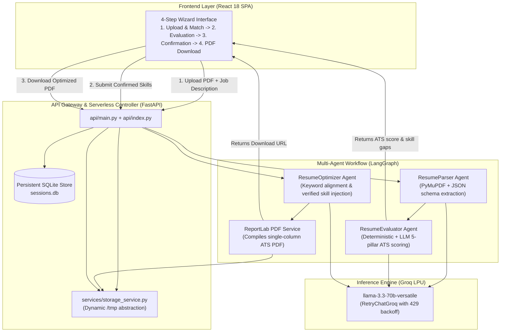

# AgentHire AI ⚡

[](https://fastapi.tiangolo.com)
[](https://langchain-ai.github.io/langgraph/)
[](https://groq.com)
[](https://www.reportlab.com)
[](https://react.dev)
[](LICENSE)

**AgentHire AI** is a production-grade, multi-agent resume evaluation, ATS optimization, and professional PDF generation web application. 

Powered by **FastAPI**, **LangGraph**, **Groq LPUs (`llama-3.3-70b-versatile`)**, **PyMuPDF**, **ReportLab**, and a zero-build **React 18** Single Page Application, AgentHire AI evaluates candidate resumes against real job postings, enforces strict anti-hallucination guardrails, allows candidates to confirm genuine competencies through human-in-the-loop verification, and compiles publication-quality, ATS-compliant PDF resumes ready for immediate submission.

---

## 🌟 Key Highlights

- **Anti-Hallucination Core**: Candidate employment history, company names, educational credentials, and dates are strictly immutable. Identified skill gaps are never fabricated into the resume unless explicitly verified by the user.
- **Transparent ATS Scoring**: Every optimization tracks `initial_score`, `final_score`, `score_delta`, and an honest `score_explanation` detailing why the score changed.
- **Enterprise PDF Engine**: Programmatically renders vector PDFs using ReportLab with clean typography, horizontal categorical skill grouping, and orphan-heading prevention.
- **High-Speed Inference**: Powered by Groq LPUs with built-in automatic backoff and retry for rate-limit protection (`RetryChatGroq`).
- **Serverless-Ready**: Automatic runtime filesystem abstraction that transparently redirects file operations to `/tmp` when running on AWS Lambda or Vercel.

---

## 🏗️ System Architecture



---

## 📊 5-Dimension ATS Scoring Model

AgentHire AI evaluates candidate alignment against target job descriptions across 5 weighted dimensions (100 Points Total):

| Dimension | Max Points | Evaluation Methodology |
| :--- | :---: | :--- |
| **Technical Skills Match** | **35 pts** | Match rate between candidate technical background and required technologies. |
| **Project & Experience Relevance** | **25 pts** | Alignment of domain complexity, responsibilities, and seniority. |
| **Education & Qualifications** | **15 pts** | **Deterministic keyword evaluation** (`_score_education`) ensuring fair, bias-free grading. |
| **ATS Formatting & Compatibility** | **15 pts** | Standard section headers, chronological layout, and parsing cleanliness. |
| **Clarity & Presentation** | **10 pts** | Action-driven phrasing, quantified achievements, and readability. |

---

## 📁 Repository Structure

```text
AGENT_HIRE/
├── agents/
│   ├── resume_parser.py          # Extracts structured JSON from raw resume text
│   ├── resume_evaluator.py       # Deterministic & LLM 5-pillar ATS evaluation
│   └── resume_optimizer.py       # Conservative optimization with anti-fabrication watchlist
│
├── workflow/
│   ├── graph.py                  # LangGraph StateGraph (analysis & optimization pipelines)
│   └── state.py                  # AgentHireState TypedDict definition
│
├── services/
│   ├── llm_service.py            # Groq provider with RetryChatGroq automatic 429 backoff
│   ├── pdf_service.py            # PyMuPDF (fitz) text extraction engine
│   ├── resume_output_service.py  # Production ReportLab PDF compiler
│   └── storage_service.py        # Environment-aware filesystem abstraction (/tmp on serverless)
│
├── api/
│   ├── main.py                   # FastAPI REST API, SQLite session manager & endpoints
│   └── index.py                  # Vercel serverless function entrypoint
│
├── templates/
│   └── index.html                # Standalone React 18 single-page application
│
├── tests/
│   └── test_pipeline.py          # Complete 7-stage unit and integration test suite
│
├── outputs/                      # Local outputs directory (auto-redirected to /tmp on Vercel)
│   ├── uploads/                  # Temporary uploaded PDFs
│   ├── resumes/                  # Generated optimized PDFs
│   ├── json/                     # Serialized candidate JSON records
│   └── data/sessions.db          # Thread-safe persistent SQLite session store
│
├── supabase_schema.sql           # Optional production Supabase PostgreSQL & S3 schema
├── vercel.json                   # Canonical Vercel deployment routing configuration
├── requirements.txt              # Production Python package dependencies
├── .vercelignore                 # Excludes local caches, virtual environments, and scratch files
├── .env                          # Local environment variables (excluded from git)
└── README.md                     # Documentation
```

---

## 🚀 Quickstart & Local Setup

### 1. Prerequisites
- **Python 3.10+** (Tested on Python 3.11, 3.12, 3.13)
- A free **Groq API Key** from [console.groq.com](https://console.groq.com)

### 2. Clone & Setup Virtual Environment
```powershell
# Clone the repository
git clone https://github.com/ganesh-sanam/AGENT-HIRE.git
cd AGENT-HIRE

# Create an isolated virtual environment
python -m venv .venv

# Activate the virtual environment
# On Windows PowerShell:
.\.venv\Scripts\Activate.ps1
# On macOS / Linux:
source .venv/bin/activate

# Upgrade pip and install pinned dependencies
python -m pip install --upgrade pip
pip install -r requirements.txt
```

### 3. Configure Environment Variables
Create a `.env` file in the project root:
```ini
GROQ_API_KEY=gsk_your_groq_api_key_here
GROQ_MODEL=llama-3.3-70b-versatile
```

### 4. Run the Application
Start the FastAPI server:
```powershell
python -m uvicorn api.main:app --reload --host 127.0.0.1 --port 8000
```

- **Web Application UI**: Open [http://127.0.0.1:8000](http://127.0.0.1:8000) in your browser.
- **Interactive OpenAPI Docs**: Open [http://127.0.0.1:8000/docs](http://127.0.0.1:8000/docs).
- **Health Check Endpoint**: Open [http://127.0.0.1:8000/health](http://127.0.0.1:8000/health).

---

## 🧪 Automated Test Suite

The project includes an end-to-end automated test suite covering ReportLab XML sanitization, skill categorization, sentence bullet parsing, SQLite session persistence, API endpoints, and path-traversal download security.

Run the test suite directly:
```powershell
# Ensure PYTHONPATH is set to the project root
$env:PYTHONPATH="."
.\.venv\Scripts\python -u tests\test_pipeline.py
```

Expected output:
```text
--- Running test_pdf_generation_formatting ---
PASSED
--- Running test_skills_categorization ---
PASSED
--- Running test_split_into_bullets ---
PASSED
--- Running test_sqlite_session_store ---
PASSED
--- Running test_api_health ---
PASSED
--- Running test_api_home_html ---
PASSED
--- Running test_api_download_security ---
PASSED

==========================================
ALL 7 PIPELINE & API TESTS PASSED SUCCESSFULLY!
==========================================
```

---

## 🌐 Production Deployment (Vercel)

The repository is configured for one-click deployment to Vercel using the canonical `@vercel/python` builder.

### 1. Vercel Configuration (`vercel.json`)
```json
{
  "version": 2,
  "functions": {
    "api/index.py": {
      "maxDuration": 60,
      "memory": 1024
    }
  },
  "builds": [
    {
      "src": "api/index.py",
      "use": "@vercel/python",
      "config": {
        "maxDuration": 60
      }
    }
  ],
  "routes": [
    {
      "src": "/(.*)",
      "dest": "api/index.py"
    }
  ]
}
```

### 2. Deployment Steps
1. Push your repository to GitHub:
   ```powershell
   git push origin main
   ```
2. Import the repository into your [Vercel Dashboard](https://vercel.com/dashboard).
3. Under **Settings $\rightarrow$ General**:
   - **Root Directory**: Leave blank or set to `./`.
   - **Framework Preset**: Set to **Other**.
4. Under **Settings $\rightarrow$ Environment Variables**, add:
   - `GROQ_API_KEY`: `gsk_...`
   - `GROQ_MODEL`: `llama-3.3-70b-versatile`
5. Click **Deploy**.

---

## 📡 REST API Reference

### 1. Health Check
```http
GET /health
```
**Response (200 OK):**
```json
{
  "status": "healthy",
  "service": "AgentHire AI API",
  "version": "1.4.0",
  "groq_configured": true
}
```

### 2. Analyze Resume
```http
POST /analyze-resume
Content-Type: multipart/form-data
```
| Parameter | Type | Description |
| :--- | :--- | :--- |
| `resume` | File (PDF) | Candidate resume in PDF format (max 10 MB) |
| `job_description` | String | Target job description text |

**Response (200 OK):**
```json
{
  "session_id": "604d652f0bd344e4b2e5977a4b65aaca",
  "status": "pending_confirmation",
  "score": 77,
  "initial_score": 77,
  "threshold": 80,
  "approved": false,
  "original_evaluation": {
    "category_scores": { ... },
    "strengths": [ "Proven LangGraph experience", "Strong FastAPI background" ],
    "weaknesses": [ "Missing ChromaDB vector search", "No Docker deployment mentioned" ]
  },
  "unconfirmed_skills": [ "ChromaDB", "Docker" ],
  "pending_confirmation": true,
  "message": "Review the skill gaps and confirm only skills you genuinely possess."
}
```

### 3. Confirm Skills & Optimize
```http
POST /confirm-skills
Content-Type: application/json
```
```json
{
  "session_id": "604d652f0bd344e4b2e5977a4b65aaca",
  "confirmed_skills": [ "ChromaDB" ]
}
```
> **Note:** Passing an empty list `[]` is 100% supported when a candidate possesses none of the missing skills. The optimizer refines phrasing and keyword visibility without fabricating experience.

**Response (200 OK):**
```json
{
  "session_id": "604d652f0bd344e4b2e5977a4b65aaca",
  "status": "completed",
  "score": 83,
  "initial_score": 77,
  "score_delta": 6,
  "score_explanation": "Score increased by 6 points (77 -> 83). 1 confirmed skill ('ChromaDB') was integrated into technical skills. Improvement driven by refined ATS phrasing and verified competence alignment.",
  "approved": true,
  "pdf_download_url": "/download-resume/optimized_resume_604d652f0bd344e4b2e5977a4b65aaca.pdf"
}
```

### 4. Download Optimized PDF
```http
GET /download-resume/{filename}
```
Streams the generated ATS-compliant PDF file with strict path-traversal validation.

---

## 🛡️ Security & Privacy Guardrails

- **Zero Data Retention**: Uploaded PDF files are deleted immediately after text extraction inside an unconditional `finally` block.
- **Path-Traversal Protection**: Download endpoints enforce strict regex filtering (`^optimized_resume_[a-zA-Z0-9_-]+\.pdf$`) to prevent directory traversal.
- **Anti-Prompt-Injection**: Confirmed skills submitted to `/confirm-skills` are strictly validated against the server-side session whitelist before invocation.
- **Enterprise Groq Terms**: Processed via Groq API under terms that do not train on user payloads.

---

## 📄 License

This project is licensed under the MIT License — see the [LICENSE](LICENSE) file for details.

© 2026 AgentHire AI. Built with FastAPI, LangGraph, ReportLab, and Groq LPUs.
